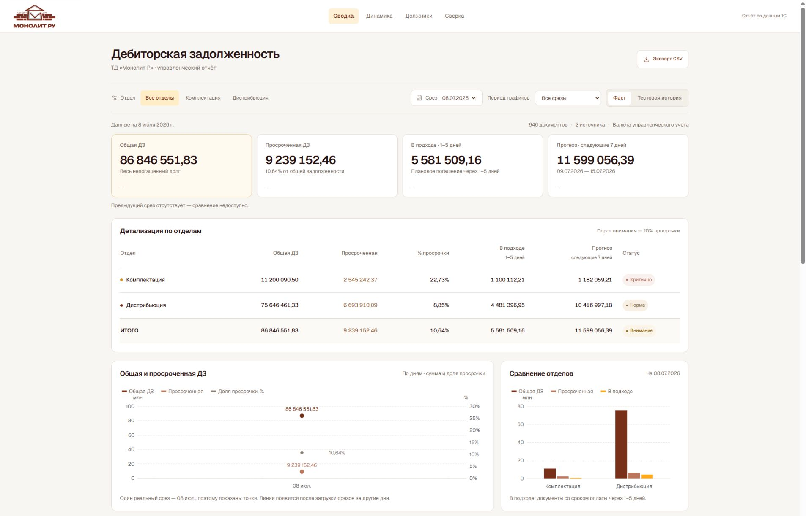
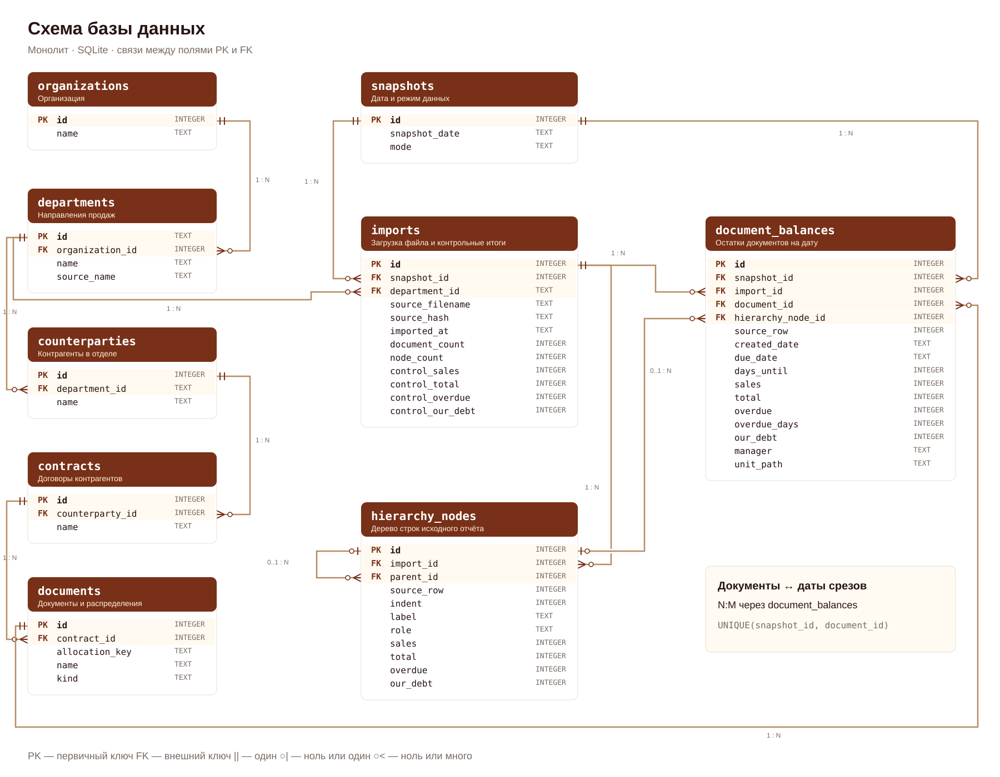

# Дебиторская задолженность — Монолит

Веб-дашборд по двум выгрузкам 1С: «Комплектация» и «Дистрибьюция». Файлы загружаются в SQLite; интерфейс получает рассчитанные показатели из базы через API.



## Возможности

- Четыре KPI с изменением к предыдущему срезу: общая ДЗ, просрочка, поступления через 1–5 дней и прогноз на ближайшие 7 дней.
- Общая и просроченная ДЗ двумя линиями; доля просрочки — пунктиром на второй оси.
- Два графика динамики по отделам и сравнение отделов столбцами.
- Детализация отделов с итоговой строкой и статусами; два топа по 15 контрагентов — по сумме и по дням просрочки.
- Фильтры отдела, даты и периода, поиск, сортировка, документы контрагента и экспорт CSV.
- Сверка с исходными итогами и отдельная тестовая история для проверки динамики.

## Запуск

Нужны Python 3.12+, Node.js 22.18+ и pnpm. Команды ниже — для Windows PowerShell.

```powershell
git clone https://github.com/AlbiDevv/monolit_test.git
cd monolit_test
python -m venv .venv
.\.venv\Scripts\python.exe -m pip install -r requirements-lock.txt
New-Item -ItemType Directory -Force data/input
```

Положите две выданные с заданием выгрузки `.xlsx` в `data/input`, затем выполните:

```powershell
.\.venv\Scripts\python.exe -m backend.cli import "data/input/*.xlsx"
.\.venv\Scripts\python.exe -m backend.cli seed-demo
.\.venv\Scripts\python.exe -m backend.cli verify
pnpm --dir frontend install --frozen-lockfile
pnpm --dir frontend build
.\.venv\Scripts\python.exe -m uvicorn backend.app:app --host 127.0.0.1 --port 8010
```

Откройте **http://127.0.0.1:8010/**. Для последующих запусков можно использовать `start.cmd`. В Linux/macOS путь к Python окружения — `.venv/bin/python`.

## Архитектура

**XLSX → парсер и импорт → SQLite → расчёты и FastAPI → React и ECharts.**

`backend/parser.py` восстанавливает иерархию по отступам столбца A. `backend/importer.py` сверяет суммы и сохраняет срез в транзакции. `backend/metrics.py` рассчитывает показатели из БД. Интерфейс находится в `frontend/src`.

**[Схема SQL](backend/schema.sql)** · **[Импорт из файлов](backend/cli.py)**



Диаграмма показывает все таблицы, поля и внешние ключи. Ограничения и индексы заданы в SQL. Отдельные срезы хранят дату и режим данных; остаток каждого документа привязан к срезу. Повторный импорт не удваивает суммы. Новый файл того же отдела и даты заменяет срез только после успешной сверки.

Линии соединяют конкретные PK и FK; кратность обозначена нотацией Crow’s Foot. Основные связи — 1:N. Документы и срезы связаны N:M через `document_balances`, с уникальностью пары `(snapshot_id, document_id)`. У `hierarchy_nodes.parent_id` и `document_balances.hierarchy_node_id` связь с родителем необязательная.

API: `/api/meta`, `/api/dashboard`, `/api/documents`, `/api/export`, `/api/health`. Описание запросов доступно на `/docs` после запуска.

## Расчёты

| Показатель | Правило |
|---|---|
| Общая ДЗ | Сумма поля «Долг клиента: Всего» на строках документов |
| Просроченная ДЗ | Сумма «Просрочено» на тех же строках |
| Доля просрочки | Просроченная / общая ДЗ; при нулевом долге — 0% |
| В подходе | Непогашенные суммы с числом дней до оплаты от 1 до 5 включительно |
| Прогноз | Непогашенные суммы с плановой датой от следующего дня после среза до седьмого дня включительно |
| Дни просрочки клиента | Максимум по его документам с положительной просрочкой |
| Статус | Норма < 10%; внимание от 10% до < 20%; критично ≥ 20% |

Промежуточные итоги и «Наш долг» не добавляются к ДЗ. Деньги хранятся в целых сотых долях. Валюта — валюта управленческого учёта, как в источниках.

На **08.07.2026**: общая ДЗ **86 846 551,83**, просрочка **9 239 152,46**, в подходе **5 581 509,16**, прогноз **11 599 056,39**. Загружено 946 строк документов; расхождение с итогами Excel — **0,00**.

В исходниках одна реальная дата. Поэтому режим «Факт» показывает точки и не выводит отсутствующие дельты. В «Тестовой истории» 14 искусственных срезов: они демонстрируют линии и сравнения, отдельно от реальных данных. Для накопления реальной истории импортируйте новые ежедневные выгрузки.

## Проверка

```powershell
.\.venv\Scripts\python.exe -m pip install -r requirements-dev.txt
.\.venv\Scripts\python.exe -m pytest -q
.\.venv\Scripts\python.exe -m ruff check backend tests scripts
pnpm --dir frontend test
pnpm --dir frontend lint
pnpm --dir frontend build
```

С исходными XLSX проверены 38 backend и 12 frontend тестов. Дополнительная сверка XML исходников, SQL и работающего API: `scripts/audit_sources.py` и `scripts/audit_history.py`. Если исходники не помещены в `data/input`, интеграционные тесты источников пропускаются.

## Скриншоты и промпты

- [Сводка на исходной дате](docs/screenshots/01-overview.jpg)
- [Тестовая история и общая динамика](docs/screenshots/02-history.jpg)
- [Динамика по отделам](docs/screenshots/03-department-dynamics.jpg)
- [Оба топа контрагентов](docs/screenshots/04-top-debtors.jpg)
- [Подход и примеры ключевых промптов](PROMPTS.md)

Исходные Excel, рабочая БД и готовая сборка передаются отдельным локальным комплектом; в репозитории находятся код, схема, команды загрузки, описание и скриншоты.
